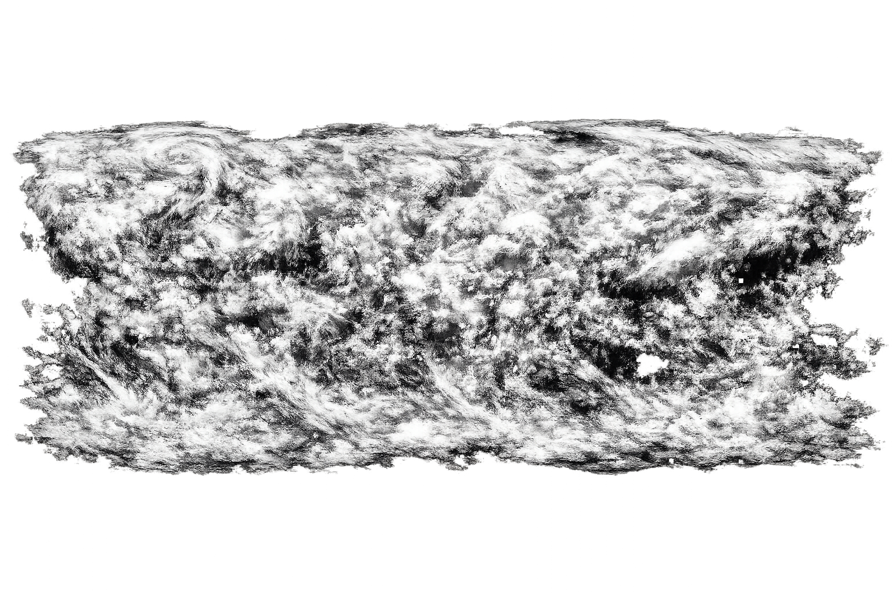

# 🌍 Earth Globe

An interactive 3D Earth visualization built with Three.js. Features realistic terrain, atmospheric glow, aurora borealis, animated flight paths, and city labels.



## Features

- **Realistic Terrain** - 3D displacement mapping from topology data
- **Day/Night Cycle** - Custom shader transitioning between day and night textures based on sun position
- **Atmospheric Glow** - Fresnel-based blue haze at the edges
- **Aurora Borealis** - Animated northern lights effect
- **City Labels** - Toggle-able labels for major cities
- **Animated Fleet** - Aircraft, balloons, airships, helicopters, and cruise ships following flight paths around the globe

## Getting Started

### Prerequisites

- Node.js 18+

### Install

```bash
npm install
```

### Development

```bash
npm run dev
```

Opens at http://localhost:5173

### Build

```bash
npm run build
```

Output in `dist/`

### Preview Production Build

```bash
npm run preview
```

## Controls

- **Drag** - Rotate the globe
- **Scroll** - Zoom in/out
- **Toggle Earth Rotation** - Enable/disable auto-rotation
- **Toggle Country Labels** - Show/hide city labels

## Project Structure

```
src/
├── main.js          # Entry point
├── Scene.js         # Scene assembly
├── Earth.js        # Earth sphere with shaders
├── Atmosphere.js   # Atmospheric glow
├── Aurora.js       # Northern lights
├── Clouds.js       # Cloud layer
├── Labels.js       # City labels
├── Fleet.js        # Animated vehicles
├── PathFollower.js # Flight path logic
├── SphericalOrientation.js
├── ModelCache.js   # GLB model caching
└── style.css      # UI styles
```

## Tech Stack

- **Three.js** - 3D rendering
- **Vite** - Build tool

## License

MIT